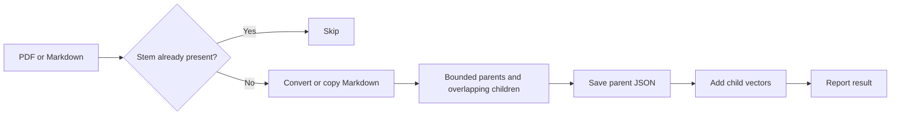
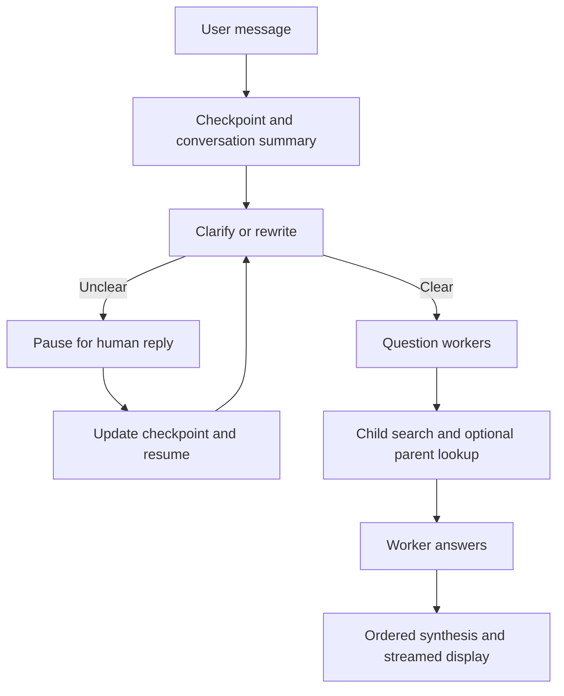

# Project Study and Interview Guide

**Sample pitch:** This project demonstrates hierarchical RAG with conversation memory, human clarification, bounded tool research, and streamed synthesis. Gradio presents the UI, LangGraph coordinates work, Ollama generates answers, and Qdrant searches children backed by JSON parents. It is a learning project, not evidence of production delivery.

## 1. Reading Order and Outcomes

1. **This overview:** connect startup, ingestion, answering, and evaluation.
2. [Core lifecycle](core.md#L1): follow initialization, uploads, streaming, and session ownership.
3. [Database and chunking](db.md#L1): explain character-based chunks, hybrid retrieval, and persistence.
4. [Graph wiring](../../Graph.md#L1): trace the main conversation graph and retrieval subgraph.
5. [Agent decisions](rag-agent.md#L1): inspect reducers, budgets, compression, and grounding limitations.

Practice the pitch, ingestion and clarification traces, relevance versus faithfulness, and improvement tradeoffs. Use [the dependency guide](../../DEPENDENCIES.md#L1) for packages.

## 2. Module Map and Startup

| Surface | Responsibility |
|---|---|
| [Entry point](../../project/app.py#L1) | Loads dotenv, imports the UI, launches Gradio |
| [UI](../../project/ui/gradio_app.py#L9) | Creates one system; binds upload, clear, chat handlers |
| [Configuration](../../project/config.py#L1) | Paths, models, chunk/retrieval settings, budgets, tracing flags |
| [Utilities](../../project/utils.py#L26) | PDF-to-Markdown conversion; separate token-estimation helper |
| [Chunker](../../project/document_chunker.py#L53) | Header-aware parent preparation and overlapping children |
| [Core](../../project/core/rag_system.py#L11) | Managers, model/tool graph, thread configuration; document/chat coordination |
| [Vector storage](../../project/db/vector_db_manager.py#L7) and [parent storage](../../project/db/parent_store_manager.py#L8) | Hybrid child index and parent JSON lookup |
| [Agent graph](../../project/rag_agent/graph.py#L21) | Clarification, worker research, compression, aggregation |
| [../../notebooks/evaluation.ipynb](../../notebooks/evaluation.ipynb) | Independent query runs, retained contexts, judge-based scoring |

[Construction and initialization](../../project/core/rag_system.py#L13) are separate: managers/providers and a thread UUID come first; collection setup, `ChatOllama`, tools, and graph compilation follow. Current [model settings](../../project/config.py#L15) use Qwen dense embeddings, sparse BM25, `granite4.1:8b` answers, and a separate Ministral 3B judge. These settings are not discovered optima.

## 3. Two End-to-End Flows

**Document ingestion:** [add_documents](../../project/core/document_manager.py#L13) accepts PDF/Markdown, skips existing stem-named Markdown, converts/copies text, then chunks it. Parents precede child vectors; failure cleanup is neither transactional nor partial-vector rollback.

**Question answering:** [chat](../../project/core/chat_interface.py#L113) reads checkpoint state, either sends a fresh message or appends a clarification reply and resumes with `None`. Workers retrieve evidence; ordered aggregation produces the final UI stream. UI history is not the sole memory.

## 4. Evaluation: Relevance Is Not Faithfulness

In [../../notebooks/evaluation.ipynb](../../notebooks/evaluation.ipynb), the query helper in section 3b resets the thread per evaluated query and collects actual retained child/parent tool contexts, not just worker prose. Judge setup in section 2 separates answer and judge models, reducing self-evaluation bias without eliminating judge error.

The five RAGAS scorers in section 7 use these inputs:

| Metric | Assessment and input boundary |
|---|---|
| Answer Accuracy | Answer versus reference, given the question |
| Context Relevance | Retrieved context relevance to the question |
| Response Groundedness | Answer support in retrieved contexts |
| Context Precision | Useful retrieved evidence/ranking, using question and reference |
| Context Recall | Reference information covered by retrieved contexts, given the question |

Relevant retrieval can still yield unsupported synthesis; grounded text can repeat an incorrect source. Reference-based correctness, relevance, and grounding are different tests. Scoring in section 7 uses the reference answer for precision/recall, not the saved `reference_contexts` field. Pipeline/judge failures become missing scores; numeric means must be read alongside failures and coverage.

These metrics do not prove citation validity, corpus completeness, safety, authorization, production reliability, or latency. Curated examples and model judges are not a general benchmark; no benchmark numbers are claimed here.

## 5. Production Discussion Roadmap

| Current demo assumption | Proposed improvement, not implemented assurance |
|---|---|
| [One shared UI system/thread](../../project/ui/gradio_app.py#L9); untrusted text enters prompts | Identity-scoped sessions, document ACLs, prompt-injection defenses, trace-data controls |
| [In-memory checkpoints](../../project/rag_agent/graph.py#L25) | Durable checkpoints, retention, recovery policy |
| [Local Qdrant ownership](../../project/db/vector_db_manager.py#L11) | Server Qdrant for shared access; still design authorization |
| [Filename skips and nontransactional writes](../../project/core/document_manager.py#L13) | Stable IDs, versioned ingestion, reconciliation and publication |
| Repeated worker/model calls and context growth | Explicit cancellation, bounded concurrency, latency/cost instrumentation; evaluate reranking or caching only as future options |

More workers can increase contention; larger parents can add noise; caches need identity/version-aware keys. Measure before optimizing.

## 6. Interview Practice

| Question | Answer guidance |
|---|---|
| What makes this agentic rather than one-shot RAG? | A model can request repeated tools inside a graph-controlled budget and compression loop. |
| Trace one upload to searchable evidence. | Conversion/copy, parent-child chunking, parent save, child embedding/indexing; acknowledge partial failure. |
| What survives a restart? | Disk document stores, not in-memory conversation checkpoints. |
| Can relevant context produce an unfaithful answer? | Yes; rewriting, compression, worker generation, and aggregation can introduce unsupported claims. |
| What would you prioritize for multiple users? | Identity and ACLs, isolated threads, safe corpus publication, then operational concurrency and recovery. |

**Tradeoff exercise:** Order the proposed improvements and name a failure test for each. Diagnose retrieval and synthesis failures separately; never present proposals as shipped work.