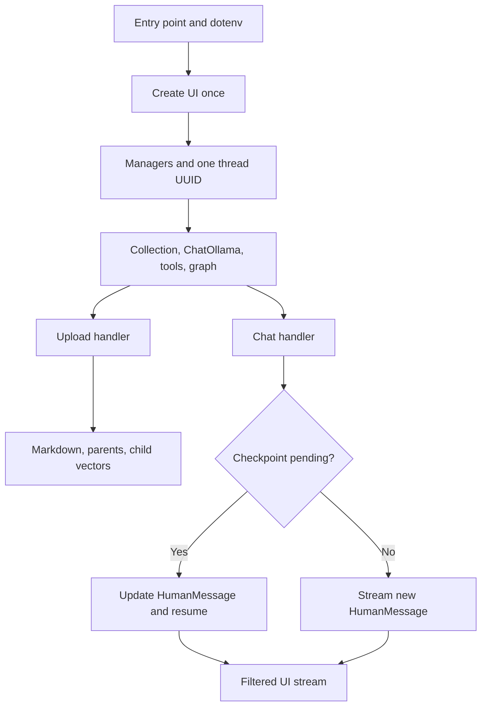

# Core Lifecycle Walkthrough

The core layer connects persistent document storage, the agent graph, and the Gradio experience. It owns application lifecycle and presentation, not the model's retrieval decisions. Read [the overview](README.md#L1) first, continue with [database and chunking](db.md#L1), then [graph wiring](../../Graph.md#L1) and [agent decisions](rag-agent.md#L1).

## 1. Responsibilities and Boundaries

| Owner | Input | Output or side effect |
|---|---|---|
| [RAGSystem](../../project/core/rag_system.py#L11) | Collection name and configuration | Managers, model/tool graph, thread configuration |
| [DocumentManager](../../project/core/document_manager.py#L6) | PDF/Markdown paths | Markdown, parent records, vector children, added/skipped counts |
| [ChatInterface](../../project/core/chat_interface.py#L57) | User message and UI history argument | Streamed display messages; checkpoint updates |
| [Observability](../../project/core/observability.py#L7) | Optional Langfuse settings | Callback handler and trace flushing |
| [Execution logger](../../project/core/execution_logger.py#L149) | Node, route, tool, and chat events | Configurable terminal previews |

The distinction matters in an interview: uploading a file is a storage workflow; answering a question is a checkpointed orchestration workflow. The core coordinates both without implementing their detailed algorithms.

## 2. Bootstrap and Ownership

[The entry point](../../project/app.py#L1) establishes the project import path and loads dotenv before importing the UI. [create_gradio_ui](../../project/ui/gradio_app.py#L9) constructs one `RAGSystem`, initializes it, and closes over the same document manager and chat interface in its handlers.

[The constructor](../../project/core/rag_system.py#L13) creates vector, parent, chunking, and observability managers, allocates a thread UUID, and leaves `agent_graph` unset. This is not a side-effect-free dependency container: [VectorDbManager.__init__](../../project/db/vector_db_manager.py#L11) opens local Qdrant and constructs dense/sparse embedding providers. Enabled observability can also attempt authentication.

[initialize](../../project/core/rag_system.py#L23) creates or checks the collection, obtains its wrapper, constructs `ChatOllama`, creates tools, and compiles the graph. Model invocation is distinct from graph compilation, although collection setup already probes an embedding.

There is no per-browser `RAGSystem` allocation here. Treat this as a single-user ownership assumption, not tenant isolation. A separate UI history does not create a separate graph thread or corpus.

## 3. Document Ingestion and Partial Failure

[add_documents](../../project/core/document_manager.py#L13) normalizes a single string to a list, filters extensions to PDF/Markdown, and processes accepted paths sequentially:

1. Derive a Markdown destination from the source stem. An existing `stem.md` skips processing, regardless of content changes or indexing state.
2. Copy Markdown or call [PDF conversion](../../project/utils.py#L33), then create parent/child chunks using the original filename as `source`.
3. Reject an empty child list. Save parent records **before** calling the collection's `add_documents` for children.
4. On an exception, attempt parent deletion and remove the generated Markdown, print the error, and increment `skipped`.

This is best-effort cleanup, not a cross-store transaction. The exception path does not roll back child points if vector insertion partially succeeded; cleanup can itself fail. `skipped` combines existing-file duplicates and caught processing failures, so it is not a clean failure metric. Unsupported extensions are filtered before counting.

[get_markdown_files](../../project/core/document_manager.py#L68) prefers sources found in parent JSON and falls back to Markdown filenames. Neither listing verifies searchable child vectors. Same-stem filenames can also collide even when their extensions or directories differ.

## 4. Streaming and Clarification

[get_config](../../project/core/rag_system.py#L35) supplies the thread ID, graph recursion limit, and optional callbacks. [chat](../../project/core/chat_interface.py#L113) reads `get_state(config).next`: pending work triggers `update_state` with a `HumanMessage`, followed by `stream(None, ...)`; otherwise it streams a fresh message input.

This resumes the interrupted clarification workflow rather than starting an unrelated conversation. The `history` argument is not replayed as the graph's memory. Checkpoint state holds conversation messages and summaries; see [the graph walkthrough](../../Graph.md#L1) for the interrupt boundary.

With `stream_mode="messages"`, node metadata selects analysis/history-summary output, tool-call previews, and final answer tokens. Only `aggregate_answers` supplies the ordinary final-answer stream; worker prose is not displayed as that final answer. [Tool-result handling](../../project/core/chat_interface.py#L98) limits its **display preview** to 300 characters. It does not truncate the tool context stored for the agent.

## 5. Reset, Clearing, and Diagnostics

[reset_thread](../../project/core/rag_system.py#L42) attempts checkpoint deletion, warns on failure, and allocates another UUID. [clear_session](../../project/core/chat_interface.py#L161) invokes that reset and flushes observability. Neither deletes the document corpus.

Conversely, [clear_all](../../project/core/document_manager.py#L74) deletes the child collection, clears Markdown and parent storage, and recreates the collection. It does not reset conversation state. These are destructive storage operations being described, not instructions executed for this guide; old conversation evidence can outlive a corpus clear.

[Observability initialization](../../project/core/observability.py#L9) disables optional Langfuse when credentials or initialization fail. Terminal logging is separate and currently disabled in [configuration](../../project/config.py#L36). [logged_node](../../project/core/execution_logger.py#L202) logs inputs/outputs and rethrows node exceptions without changing successful return values. Logging and tracing help locate failures; neither proves answer correctness or sanitizes sensitive content.

## 6. Interview Practice

| Question | Answer guidance |
|---|---|
| What does construction do versus initialization? | Construction opens managers/providers and creates a thread; initialization checks storage and builds model/tools/graph. Neither is merely UI wiring. |
| Why is the ingestion order important? | Parents must exist for expansion, but saving them before vectors creates a partial-failure window. Cleanup is not atomic rollback. |
| How does clarification resume? | Detect pending checkpoint work, append the human reply, then stream with `None`; do not replay UI history as the only memory. |
| Does clearing chat clear documents? | No. Thread reset and corpus deletion have different owners, persistence, and risks. |
| What breaks with multiple users? | UI handlers share a system, thread, and corpus. Proposed identity-scoped threads and authorized document access are additional work. |

**Tradeoff exercise:** Design per-user session ownership while sharing an index. Explain thread allocation, authorization filters, cancellation, and safe handling of corpus updates. Separate those proposed changes from the current single-instance behavior.