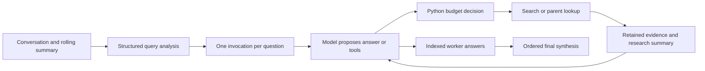

# RAG Agent Decision Walkthrough

This guide explains decisions, evidence, and failure modes rather than repeating [the full graph wiring](../../Graph.md#L1). Reading order: [overview](README.md#L1), [core](core.md#L1), [database](db.md#L1), graph wiring, then this guide.

## 1. Inputs, State, and Merge Rules

| Owner | Input | Output or state contract |
|---|---|---|
| [State](../../project/rag_agent/graph_state.py#L16) | Conversation messages and summaries | Original/pending query, clarification history, rewritten questions, worker answers |
| [AgentState](../../project/rag_agent/graph_state.py#L26) | One question and its index | Worker messages, evidence, research summary, counters, answer |
| [QueryAnalysis](../../project/rag_agent/schemas.py#L4) | Structured model response | Clarity flag, question list, clarification text |
| [ToolFactory](../../project/rag_agent/tools.py#L6) | Query or parent ID | Search/parent evidence strings or error sentinels |
| [Aggregation](../../project/rag_agent/nodes.py#L313) | Original query and worker answers | Final conversation message |

Both state classes inherit message merging from `MessagesState`. [Reducers](../../project/rag_agent/graph_state.py#L5) give other fields distinct semantics: main `agent_answers` accumulate, except a `__reset__` marker clears them; worker counters add deltas; `retrieved_contexts` append unique strings; `retrieval_keys` use set union. An update is not necessarily replacement, and string deduplication is not semantic evidence deduplication.

This is a conceptual ownership diagram, not a complete routing specification.

## 2. Memory, Rewriting, and Clarification

[summarize_history](../../project/rag_agent/nodes.py#L77) resets previous worker answers and merges older plain conversation into a rolling summary, retaining recent messages. [rewrite_query](../../project/rag_agent/nodes.py#L110) combines that summary, recent conversation, and any pending query/clarification replies. Internal worker messages are named so they are not treated as ordinary conversation.

`with_structured_output(QueryAnalysis)` establishes a format contract, not factual truth. The [rewrite prompt](../../project/rag_agent/prompts.py#L21) requests at most three questions, but the schema's `List[str]` has no maximum-length validator. Unclear requests preserve pending state; the [interrupt](../../project/rag_agent/graph.py#L59) pauses before the no-op clarification node. The [core guide](core.md#L1) explains how the next human reply resumes execution.

[Send fan-out](../../project/rag_agent/edges.py#L7) creates a worker invocation per rewritten question with its index and empty messages. These are parallel graph tasks using the same configured model, not necessarily parallel hardware inference or measured latency improvements.

## 3. Tool Decisions and Evidence

[orchestrator](../../project/rag_agent/nodes.py#L173) invokes the tool-bound model. Its first call includes a forceful instruction to search first, but no Python branch guarantees that the model complies. The [orchestrator prompt](../../project/rag_agent/prompts.py#L44) also asks for document grounding, nonrepeated retrieval, and filename citations; those requests are not correctness checks.

[create_tools](../../project/rag_agent/tools.py#L83) builds two `@tool`-equivalent wrappers, `search_child_chunks` and `retrieve_parent_chunks`, executed by [ToolNode](../../project/rag_agent/graph.py#L23). [Search](../../project/rag_agent/tools.py#L12) returns child excerpts with `Parent ID`, `File Name`, and `Content`; [parent lookup](../../project/rag_agent/tools.py#L51) expands a selected ID. Expansion is optional, not automatic for every hit.

Empty search returns `NO_RELEVANT_CHUNKS`; exceptions return `RETRIEVAL_ERROR:` or `PARENT_RETRIEVAL_ERROR:` text. These are ordinary tool-result strings, not typed failure transitions. [Evidence extraction](../../project/rag_agent/nodes.py#L26) excludes these prefixes and `NO_PARENT_DOCUMENT` from retained contexts, but the model can still see the raw tool messages. Source metadata supports attribution; no code here guarantees absence of fabricated citations.

## 4. Budgets: Exact Boundary Behavior

Each orchestrator response increments `iteration_count` by one and adds the number of requested tools to `tool_call_count`. [Routing](../../project/rag_agent/edges.py#L18) sees counters that already include that response:

1. No tool calls: collect the answer first, even at the boundary.
2. Tool calls present: use fallback if `iteration_count >= MAX_ITERATIONS` or `tool_call_count > MAX_TOOL_CALLS`.
3. Otherwise execute the requested tools.

With [current limits](../../project/config.py#L28), eight requested calls can be allowed, a ninth exceeds the tool budget, and iteration ten cannot request more tools. Counts include requests, not only successfully executed calls. [Fallback](../../project/rag_agent/nodes.py#L192) uses existing tool messages and compressed context. The separate graph recursion limit bounds graph execution steps, not the same quantity as worker iterations.

## 5. Compression and Answer Collection

[should_compress_context](../../project/rag_agent/nodes.py#L222) records attempted search/parent keys and extracted evidence, then returns a `Command` containing state updates and the next node. Its threshold grows with summary size. Keys record requested retrieval, not proof of successful lookup.

[Token estimation](../../project/utils.py#L53) uses a cached GPT-family tiktoken encoding, falling back to character-based estimates. It is not Ollama's exact tokenizer. [compress_context](../../project/rag_agent/nodes.py#L259) summarizes research, appends already-attempted keys, and removes messages after the initial worker question. Evidence remains separately in `retrieved_contexts`; the model-facing summary can still lose or distort details.

[collect_answer](../../project/rag_agent/nodes.py#L298) accepts nonempty AI content without tool calls and packages answer, question index, and retained contexts. It does not assess factual validity. [aggregate_answers](../../project/rag_agent/nodes.py#L313) sorts by index and prompts with the original query and worker **answer strings**, not their raw context arrays. Its [synthesis prompt](../../project/rag_agent/prompts.py#L131) is not independent fact verification.

## 6. Failure Diagnosis and Interview Practice

| Symptom | First static explanation to investigate |
|---|---|
| Fluent answer without evidence | First-search instruction is prompt-only; no-tool output routes directly to collection. |
| Empty or broken retrieval | Distinguish no hits, child-search errors, and parent-load errors before changing prompts. |
| Evidence disappears from the final claim | Compare retained contexts, compression summary, worker answers, and aggregation; each transformation can lose detail. |

| Question | Answer guidance |
|---|---|
| Why separate shared and worker state? | Conversation survives turns; research state and additive budgets belong to each question. |
| Does structured output enforce three valid questions? | No. It validates declared fields/types; the three-question cap is prompt-only. |
| Are tool and recursion limits interchangeable? | No. Requested tools, worker model iterations, and graph steps count different events. |
| Does compression delete all evidence? | It removes older worker messages, while separately retained contexts survive; summaries remain lossy. |
| Why can citations still be wrong? | Filename metadata and prompts help, but aggregation consumes generated answers and no citation validator checks claims. |

**Tradeoff exercise:** Propose a hard fan-out bound and evidence-aware final verification. Explain added validation failures, judge cost, latency, and abstention behavior. Those safeguards are improvements, not features proved by prompts or tracing.