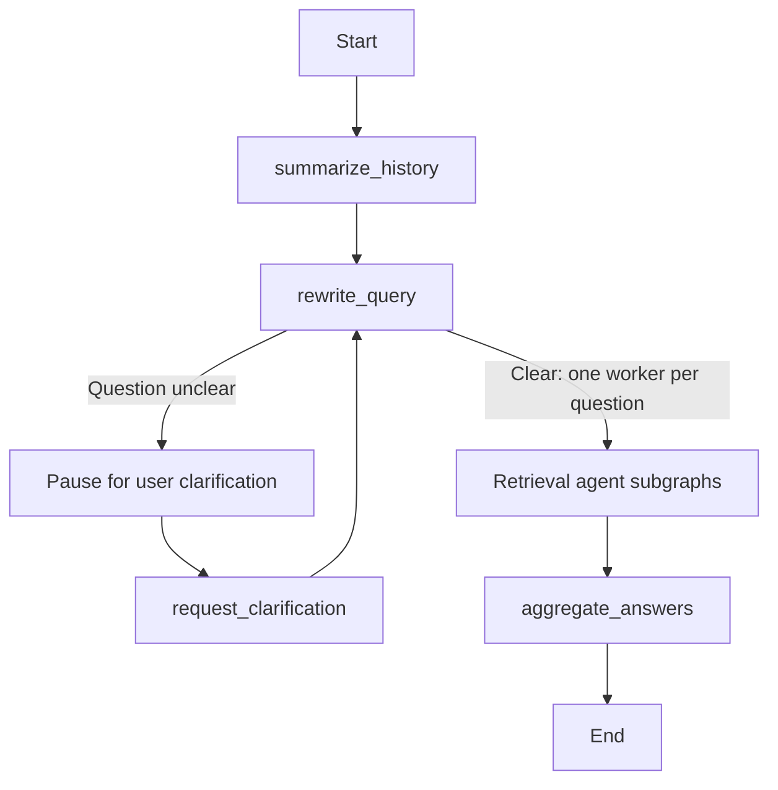
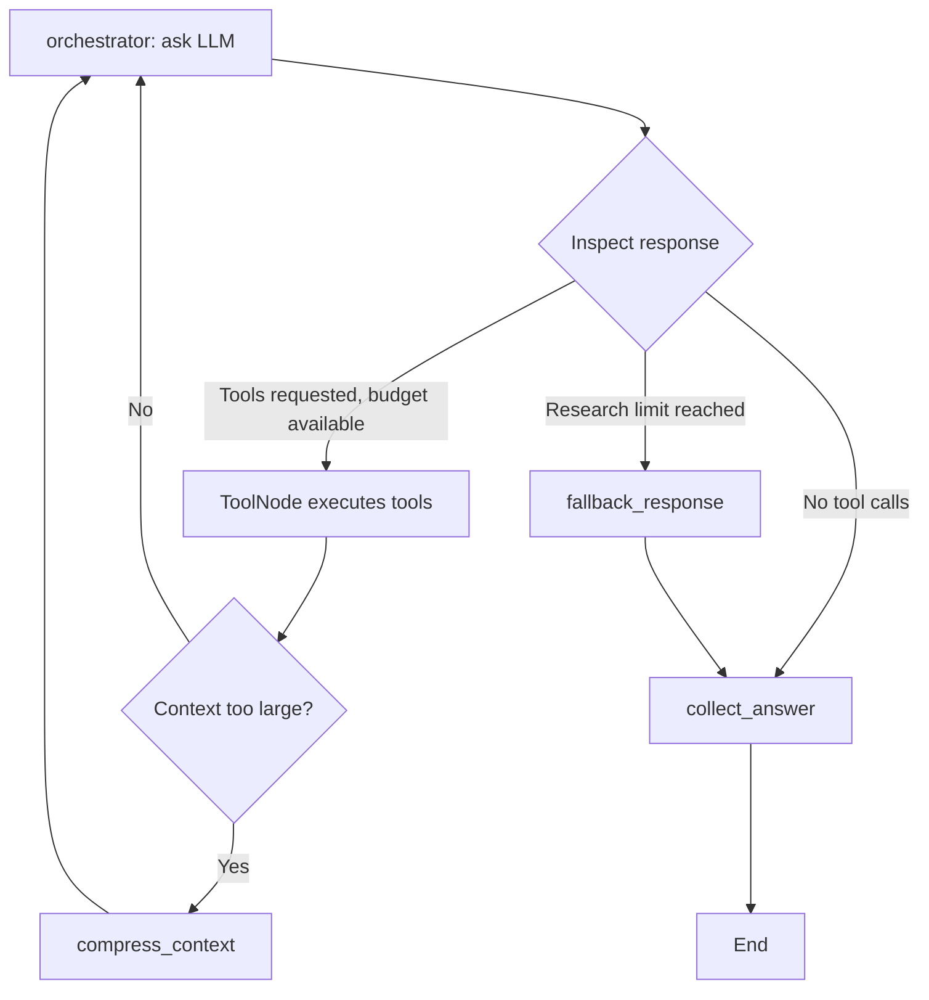

# Agent Graph Walkthrough

For the surrounding application layers and interview preparation, start with the [Project Study and Interview Guide](README.md#L1).

`agent_graph` is an **executable workflow around the LLM**, not the model itself. It coordinates conversation history, query clarification, retrieval, and answer generation.

[create_agent_graph](../../project/rag_agent/graph.py#L21) builds two layers: a main conversation graph and a retrieval-agent subgraph. The main graph manages the request; each worker researches one rewritten question.

## 1. Main Workflow

The [main graph](../../project/rag_agent/graph.py#L45) handles the conversation and coordinates the workers:

- [summarize_history](../../project/rag_agent/nodes.py#L77) summarizes older conversation when needed and clears worker answers from the previous request.
- [rewrite_query](../../project/rag_agent/nodes.py#L110) resolves references, checks clarity, and may split the request into several questions.
- The [agent subgraph](../../project/rag_agent/graph.py#L28) researches each rewritten question independently.
- [aggregate_answers](../../project/rag_agent/nodes.py#L313) combines the workers' answers into one final response.

When the question is clear, [route_after_rewrite](../../project/rag_agent/edges.py#L7) returns a [Send("agent", {...})](../../project/rag_agent/edges.py#L12) invocation for each rewritten question. `Send` selects the worker node and supplies that worker's input state: its question, question index, and empty message list. This fans the work out to separate subgraph executions. Workers use the same configured model; they do not require separate model installations.

## 2. Retrieval Loop

Each worker runs the [inner graph](../../project/rag_agent/graph.py#L28), alternating between model decisions and tool execution:

[orchestrator](../../project/rag_agent/nodes.py#L173) asks the model what to do next. The model can request tools or return an answer; [collect_answer](../../project/rag_agent/nodes.py#L298) packages the result for the main graph.

- **LLM chooses tool calls.** [llm.bind_tools(tools_list)](../../project/rag_agent/graph.py#L22) exposes the [available tools](../../project/rag_agent/tools.py#L83) to it.
- **Python executes those calls.** [ToolNode](../../project/rag_agent/graph.py#L23) runs [search_child_chunks](../../project/rag_agent/tools.py#L12) to find relevant excerpts and [retrieve_parent_chunks](../../project/rag_agent/tools.py#L51) to load fuller context.
- **Routing enforces the research budget.** [route_after_orchestrator_call](../../project/rag_agent/edges.py#L18) checks iteration and tool-call counts. If more tool calls are requested after the limit is reached, [fallback_response](../../project/rag_agent/nodes.py#L192) synthesizes an answer from the evidence already collected. A response without tool calls goes directly to collection.

### Context Compression

After tools run, [should_compress_context](../../project/rag_agent/nodes.py#L222) estimates the current context size and returns a routing command:

- [Command(goto="orchestrator")](../../project/rag_agent/nodes.py#L251) continues the research loop without compression.
- [Command(goto="compress_context")](../../project/rag_agent/nodes.py#L251) invokes [compress_context](../../project/rag_agent/nodes.py#L259), which summarizes the research context before returning to the orchestrator.

The implementation uses one [Command(update=..., goto=goto)](../../project/rag_agent/nodes.py#L251) return: it records retrieval keys and contexts while choosing the next node. Unlike [Send](../../project/rag_agent/edges.py#L12), which creates worker invocations with their own input state, `Command` updates the current worker's state and selects its next step. These outgoing routes are selected inside the node rather than declared as ordinary edges in the graph builder.

## 3. Clarification and Resumption

Clarification is a pause in the main workflow, not another retrieval tool:

1. [rewrite_query](../../project/rag_agent/nodes.py#L110) detects an unclear request and creates the clarification message.
2. The [checkpoint interrupt](../../project/rag_agent/graph.py#L59) pauses execution before `request_clarification`, allowing the caller to obtain the user's reply.
3. [request_clarification](../../project/rag_agent/nodes.py#L169) itself returns `{}`. When execution resumes, the graph routes back to query rewriting.

The no-op node marks the clarification boundary; it does not generate the question shown to the user.

The caller checks [get_state(config)](../../project/core/chat_interface.py#L120), appends the reply through [update_state(...)](../../project/core/chat_interface.py#L125), and [streams the graph](../../project/core/chat_interface.py#L134) with `stream_input = None` to resume pending work. A new request instead supplies a fresh message input.

## 4. Building Blocks and State

These links point to the APIs' usage in this project, not their third-party library definitions.

| Code | Meaning |
|---|---|
| [Send("agent", {...})](../../project/rag_agent/edges.py#L12) | Creates a worker invocation with a specific question and worker input state. |
| [Command(update=..., goto=...)](../../project/rag_agent/nodes.py#L251) | Applies state updates and selects the next node within the current worker. |
| [StateGraph(State)](../../project/rag_agent/graph.py#L45) | Main conversation workflow. [State](../../project/rag_agent/graph_state.py#L16) holds history, rewritten questions, and collected answers. |
| [StateGraph(AgentState)](../../project/rag_agent/graph.py#L28) | Per-worker retrieval workflow. [AgentState](../../project/rag_agent/graph_state.py#L26) holds the question, context, counters, and answer. |
| [add_node(...)](../../project/rag_agent/graph.py#L46) | Registers a function or compiled subgraph as a workflow node. |
| [add_edge(...)](../../project/rag_agent/graph.py#L52) | Declares a fixed transition between workflow steps. |
| [add_conditional_edges(...)](../../project/rag_agent/graph.py#L54) | Delegates routing to a function that can select a node or return worker invocations. |
| [partial(orchestrator, llm_with_tools=...)](../../project/rag_agent/graph.py#L29) | Supplies the model dependency; LangGraph supplies `state` when running the node. |
| [logged_node(...)](../../project/core/execution_logger.py#L202) | Wraps a node with logging without changing its returned result. |
| [.compile()](../../project/rag_agent/graph.py#L43) | Builds the runnable workflow; it does **not** run the LLM yet. |
| [InMemorySaver()](../../project/rag_agent/graph.py#L25) | Keeps checkpoints per thread in memory. They do not survive a process restart. |
| [interrupt_before=[...]](../../project/rag_agent/graph.py#L59) | Pauses execution so the caller can obtain human input and resume. |
| [get_state(config)](../../project/core/chat_interface.py#L120) | Reads the thread checkpoint, including whether execution has pending work. |
| [update_state(...)](../../project/core/chat_interface.py#L125) | Adds the user's clarification reply to checkpoint state before resuming. |
| [stream(..., stream_mode="messages")](../../project/core/chat_interface.py#L134) | Runs or resumes the graph and yields message chunks with node metadata. |

State updates follow each field's merge rules; they do not all replace the previous value. The [worker counters](../../project/rag_agent/graph_state.py#L26) use addition, while the main graph's [agent_answers reducer](../../project/rag_agent/graph_state.py#L5) accumulates worker results or clears them when it receives a reset marker.

## 5. Example Request

For "What is JavaScript, and what is blockchain?", the main graph can produce two rewritten questions. Each retrieval worker searches for evidence independently, and [aggregate_answers](../../project/rag_agent/nodes.py#L313) combines their answers.

The essential pattern is: **understand the request, retrieve evidence in focused workers, then synthesize a shared answer**.