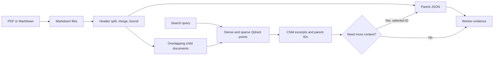

# Database and Chunking Walkthrough

This project searches small child chunks and optionally expands them into larger parents. Storage is not one database: Markdown files, parent JSON, and local Qdrant points have independent lifecycles. Read [the overview](README.md#L1) and [core lifecycle](core.md#L1) first; continue with [graph wiring](Graph.md#L1), then [agent decisions](rag-agent.md#L1).

For the class-level initialization, JSON operations, collection checks, and write/query flows, see [Chunk Storage and Query Managers](storage-managers.md#L1). For the text-splitting passes and tool invocation examples, see the [Document Chunking Walkthrough](document-chunker.md#L1).

## 1. Storage and I/O Boundaries

| Component | Input | Stored or returned output |
|---|---|---|
| [Markdown preparation](../../project/utils.py#L26) | PDF, or a Markdown copy through the document manager | Text under the configured Markdown directory |
| [DocumentChunker](../../project/document_chunker.py#L7) | Markdown path and optional source name | Parent-ID/document pairs and child documents |
| [ParentStoreManager](../../project/db/parent_store_manager.py#L8) | Parent ID, text, metadata | One JSON file per parent; content on lookup |
| [VectorDbManager](../../project/db/vector_db_manager.py#L7) | Child documents and embedding configuration | Dense/sparse child representations in local Qdrant |
| [Retrieval tools](../../project/rag_agent/tools.py#L12) | Query or selected parent ID | Text evidence containing filename, parent ID, content |

[Configured directories](../../project/config.py#L6) separate Markdown, parent storage, and Qdrant. These disk-backed artifacts survive process restarts; the conversation checkpointer described in [Graph.md](Graph.md#L1) is in memory. Persistence does not imply backup, integrity checking, or transactional consistency.



## 2. Chunking Is Character-Based

[DocumentChunker.__init__](../../project/document_chunker.py#L8) validates size relationships and creates a header splitter plus a recursive character splitter. [Current settings](../../project/config.py#L41) use 500-character children with 100-character overlap and parent targets of 2,000-4,000 characters, splitting on H1-H3 headings. These are configuration choices, not demonstrated optima or LLM-token budgets.

[create_chunks_single](../../project/document_chunker.py#L53) retains headers, merges short sections, splits oversized parents, cleans small fragments, then creates children. [Metadata merging](../../project/document_chunker.py#L28) combines differing header values using ` -> ` while deduplicating values. A parent can therefore span multiple original sections.

[Large-parent splitting](../../project/document_chunker.py#L102) also uses the configured child-overlap value. [Cleanup and rebalancing](../../project/document_chunker.py#L155) try to merge or redistribute short fragments without exceeding the maximum. A short document may remain below the minimum; the final explicit invariant rejects parents above `MAX_PARENT_SIZE`. Do not describe the minimum as a universal guarantee.

Character lengths are separate from [message token estimation](../../project/utils.py#L53). Changing language, formatting, or model tokenizer changes their relationship.

## 3. Identity and Metadata Contract

[__create_child_chunks](../../project/document_chunker.py#L184) derives each parent ID as `f"{doc_path.stem}_p{i}"`, starting at zero, and adds `source` and `parent_id` to its metadata. Children inherit that metadata through `split_documents`; existing header keys can also be present. The project assigns no explicit child ID here and passes no child point IDs during [ingestion](../../project/core/document_manager.py#L13); Qdrant point identity is delegated to the library.

Illustrative only: converting a PDF named `handbook.pdf` to Markdown with stem `handbook` could produce this parent's JSON payload:

```json
{
  "page_content": "# Guide\nIllustrative parent text.",
  "metadata": {
    "H1": "Guide",
    "source": "handbook.pdf",
    "parent_id": "handbook_p0"
  }
}
```

Its children carry the same `source` and `parent_id`, but shorter `page_content`. This deliberately short example illustrates fields, not actual chunk lengths or retrieved evidence. [The UI ingestion path](../../project/core/document_manager.py#L13) supplies the original filename; direct chunker calls without `source_name` default to `stem.pdf`, even for Markdown input.

Filename stems are not content hashes or globally unique document identities. Same-stem uploads collide at the Markdown skip check, and positional parent IDs can change meaning after re-chunking.

## 4. Hybrid Retrieval and Parent Expansion

[Vector construction](../../project/db/vector_db_manager.py#L11) uses `HuggingFaceEmbeddings` for dense Qwen embeddings and `FastEmbedSparse` for sparse BM25. [Configuration](../../project/config.py#L15) names their models; SentenceTransformers and FastEmbed are the respective backends described in [the dependency guide](../../DEPENDENCIES.md#L1).

[create_collection](../../project/db/vector_db_manager.py#L29) probes the dense dimension, creates a cosine collection with a sparse-vector slot, or rejects a detected dimension mismatch. This is not a full embedding-model, revision, or ingestion-version fingerprint: different models can share dimensions.

[get_collection](../../project/db/vector_db_manager.py#L59) selects `RetrievalMode.HYBRID`. Fusion is delegated to the integration; there is no project-defined RRF or reranker in this path. [Child search](../../project/rag_agent/tools.py#L12) passes a limit and score threshold, currently defaulting to 7 and 0.4 in [configuration](../../project/config.py#L23). A returned score is not an answer-confidence probability.

[Parent retrieval](../../project/rag_agent/tools.py#L51) loads a selected ID when broader context is needed. It does not preload every parent or automatically expand every hit.

## 5. Consistency and Operational Limits

[Parent loading](../../project/db/parent_store_manager.py#L32) reads and parses JSON directly. Missing files, invalid JSON, or missing required fields raise; the tool converts those exceptions to `PARENT_RETRIEVAL_ERROR`. By contrast, [source listing](../../project/db/parent_store_manager.py#L55) skips I/O and JSON-decoding errors. A plausible file list can hide a broken lookup.

Local Qdrant uses an exclusive index lock: the app and a notebook cannot concurrently own the same index path; see [local client construction](../../project/db/vector_db_manager.py#L11) and [dependency notes](../../DEPENDENCIES.md#L1). Server Qdrant would be a proposed concurrency option, not the current deployment.

Ingestion spans three stores without a transaction. Partial vector writes, stale parents, same-stem skips, and destructive [clear/reindex behavior](../../project/core/document_manager.py#L74) require care. Versioned ingestion, stable document IDs, reconciliation, and atomic publication are future improvements, not existing safeguards.

## 6. Interview Practice

| Question | Answer guidance |
|---|---|
| Why separate children from parents? | Small children improve retrieval granularity; selected parents restore context at a latency/token cost. |
| Are chunk sizes token limits? | No, they are character limits/targets. Context management estimates tokens separately. |
| Why combine dense and sparse search? | Semantic similarity and lexical matching complement each other; the integration performs hybrid retrieval without a custom project reranker. |
| Does dimension validation make reuse safe? | It catches incompatible dimensions, not model/version changes with equal dimensions or changed preprocessing. |
| How would you tune chunk size, K, and threshold? | Evaluate representative queries and evidence coverage against latency and noise; no universal setting follows from these defaults. |

**Tradeoff exercise:** Design a versioned reindex that keeps the old corpus readable until all new parent and child writes succeed. Specify identity, publication, rollback, and orphan cleanup without assuming a cross-store transaction already exists.