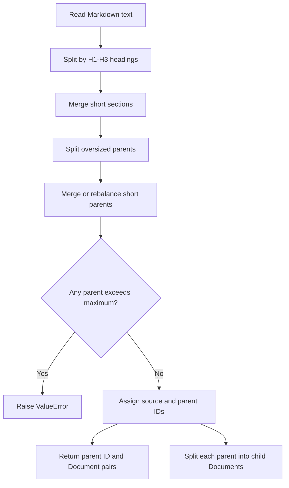

# Document Chunking Walkthrough

[DocumentChunker](../../project/document_chunker.py#L7) turns Markdown into **larger parent chunks for context** and **smaller child chunks for search**. Its job is text preparation: it does not convert PDFs, generate embeddings, or write a database. The document manager performs conversion/copying and persists the returned chunks.

Read [the project overview](README.md#L1) for the application flow and [the database guide](db.md#L1) for how parents and children are stored and retrieved.

For the implementation of the two storage managers and their shared parent-child contract, see [Chunk Storage and Query Managers](storage-managers.md#L1).

## 1. Public API and Return Values

| Entry Point | Input | Result |
|---|---|---|
| [create_chunks_single](../../project/document_chunker.py#L53) | A Markdown path and optional `source_name` | Parent-ID/document pairs and child documents for one file |
| [create_chunks](../../project/document_chunker.py#L42) | A directory, defaulting to the configured Markdown directory | The combined results from sorted, nonrecursive `*.md` matches |

Both return `(all_parent_chunks, all_child_chunks)`. The parent list contains tuples such as `("handbook_p0", parent_document)`; the child list contains LangChain `Document` objects. Each document has `page_content` and `metadata`.

The batch method delegates to the single-file method. It does not merge text across files. The [ingestion caller](../../project/core/document_manager.py#L13) supplies the original filename, saves parents, and adds children to the vector collection.

## 2. Configuration: Characters, Not Tokens

The [current settings](../../project/config.py#L41) are:

| Setting | Default | Meaning |
|---|---:|---|
| `MIN_PARENT_SIZE` | 2,000 | Target minimum parent length used for merging and rebalancing |
| `MAX_PARENT_SIZE` | 4,000 | Maximum allowed final parent length |
| `CHILD_CHUNK_SIZE` | 500 | Maximum chunk size configured on the child character splitter |
| `CHILD_CHUNK_OVERLAP` | 100 | Overlap setting used by both child splitting and oversized-parent splitting |
| `HEADERS_TO_SPLIT_ON` | H1, H2, H3 | Markdown heading levels used to find initial sections |

These lengths use Python string characters, not words, bytes, or model tokens. The recursive splitters use their default character length function; the custom parent checks use `len(page_content)`. The separate [context-token estimator](../../project/utils.py#L53) is not part of this algorithm.

[Initialization](../../project/document_chunker.py#L8) rejects nonpositive minimums, a maximum below the minimum, overlap outside `0 <= overlap < child_size`, or overlap greater than or equal to the parent maximum. It creates a header splitter with `strip_headers=False` and a reusable child splitter. Retaining headings does not imply byte-for-byte preservation of Markdown whitespace.

## 3. Processing Pipeline

The ordering in [create_chunks_single](../../project/document_chunker.py#L53) is important:



### Pass A: Split by Markdown Headings

`MarkdownHeaderTextSplitter` finds heading-based sections and records heading values in metadata such as `H1`, `H2`, and `H3`. With `strip_headers=False`, heading text remains in the content. These initial sections are not yet the final parents: later passes can combine sections or divide a long section.

### Pass B: Merge Small Sections

[__merge_small_parents](../../project/document_chunker.py#L76) walks sections in order. It accumulates text, inserting `\n\n` between sections, until the current length reaches the minimum, then emits that parent candidate.

If the file ends with a short remainder, it appends the remainder to the last emitted parent. If nothing has been emitted, it keeps the remainder by itself. This pass does **not** enforce the maximum; its result can exceed 4,000 characters, which is why the next pass exists.

### Pass C: Split Oversized Parents

[__split_large_parents](../../project/document_chunker.py#L102) keeps candidates within the maximum. For an oversized candidate it creates another `RecursiveCharacterTextSplitter` with the parent maximum as its chunk size and the configured child-overlap value as its overlap setting.

The splitter prefers its available text separators and ultimately can split at character boundaries. A Markdown section or sentence is therefore not guaranteed to stay intact. The overlap setting is a target governed by splitting boundaries, not a promise that every adjacent pair shares exactly 100 characters.

### Pass D: Clean Up Short Parents

[__clean_small_chunks](../../project/document_chunker.py#L155) first tries to absorb any remaining short parent:

1. Merge it backward into the previous retained parent if `previous_length + 2 + current_length <= maximum`.
2. Otherwise prepend it to the next parent if that combined length fits.
3. Otherwise keep it for the rebalancing pass.

The extra two characters account for the inserted `\n\n`. Forward merging updates the next item before the loop reaches it. Metadata is merged in document order, including when a short chunk is prepended.

### Pass E: Rebalance Neighbouring Parents

For a retained short parent, cleanup calls [__rebalance_pair](../../project/document_chunker.py#L118) with the next parent, or the previous parent for the final item. A single remaining parent is left alone.

Rebalancing joins the two texts with a blank line and chooses a split near the middle. It bounds the split so neither side should exceed the maximum. When the combined text is long enough to support two minimum-sized chunks, it also constrains both sides toward the minimum. It tries paragraph, newline, and space boundaries near that position, falling back to a character boundary when necessary.

Both resulting parents receive the merged metadata. Rebalancing does **not** deduplicate overlap already present in neighbouring texts, and it does not explicitly add a new overlap at the new split. This is a bounded cleanup pass, not an iterative solver that proves every parent meets the minimum.

The final explicit check rejects any parent longer than `MAX_PARENT_SIZE`. There is no equivalent final rejection for an undersized parent: **maximum is enforced; minimum is best-effort**.

### Pass F: Assign Identity and Create Children

[__create_child_chunks](../../project/document_chunker.py#L184) enumerates the final parents, assigns their IDs and source metadata, stores the parent pairs in the return list, then calls the child splitter separately for each parent. Children inherit the parent metadata and never span two final parents.

Child overlap is applied within each parent, not across the whole file as one continuous sequence. The short final child of a parent can be much smaller than the configured maximum.

## 4. Worked Size Examples

The following examples use the default settings and synthetic text. They illustrate the individual passes, not retrieval quality or recommended tuning values. Separator-rich Markdown can produce different boundaries and child counts.

| Example | Input | Result |
|---|---|---|
| Merge and append the tail | Section lengths 1,000, 1,200, and 300 | One 2,504-character candidate: both inserted blank lines count toward the length |
| Split an oversized parent | One 6,000-character string with no separators | Parents of 4,000 and 2,100 characters; their 100-character overlap explains the repeated text |
| Rebalance rather than merge | Parents containing 3,500 `a` characters and 1,000 `b` characters | They cannot merge under the maximum; the 4,502-character combined text splits into 2,251 and 2,251 |
| Short document | A small Markdown document below 2,000 characters | One short parent is retained rather than discarded for missing the minimum |
| Empty document | No Markdown content | Empty parent and child lists; the ingestion caller separately rejects a document with no children |

For the separator-free 6,000-character example, the default child splitter produces 15 children across the two parents. Do not generalize that count to ordinary Markdown or other splitter versions/settings.

## 5. Metadata and Parent-Child Identity

[__merge_metadata](../../project/document_chunker.py#L28) preserves existing keys and combines conflicting values as ordered, deduplicated strings separated by ` -> `. For example, merging `H2: "Install"` with `H2: "Usage"` yields `H2: "Install -> Usage"`. With `prepend=True`, earlier text's values are placed first. It does not reconstruct a new hierarchical section tree.

After cleanup, parent IDs follow `f"{doc_path.stem}_p{i}"`, starting at zero. For a Markdown path named `handbook.md` and an explicitly supplied `source_name="handbook.pdf"`, the first parent and its children contain metadata such as:

```json
{
  "H1": "Guide",
  "H2": "Install -> Usage",
  "source": "handbook.pdf",
  "parent_id": "handbook_p0"
}
```

This is an illustrative schema, not a real document or measured chunk. The parent JSON store uses the parent ID for lookup; a child search result carries that ID so the agent can request the larger parent.

Important identity limits:

- Parent IDs are based on filename stems and final positions, not content hashes. Re-chunking can change what an ID refers to.
- The chunker does not assign explicit child vector IDs; that is delegated to the vector-store integration during ingestion.
- If `source_name` is omitted, the fallback is `stem.pdf`, even when the input itself is Markdown. Pass the original filename explicitly when accurate source attribution matters.

## 6. Searching the Chunked Data

Chunking and searching are different stages. Calling `create_chunks_single` only returns Python objects; it does not make them searchable. [Document ingestion](../../project/core/document_manager.py#L13) saves the parent pairs through [save_many](../../project/db/parent_store_manager.py#L22) and passes the child documents to the vector collection's `add_documents` method.

Once ingestion succeeds, the two tools created by [ToolFactory.create_tools](../../project/rag_agent/tools.py#L83) connect those stores back to the agent:

| Python Variable | Registered Tool Name | Input | Data Access |
|---|---|---|---|
| `search_tool` | `search_child_chunks` | A query string and optional `limit` | Searches indexed child documents through the configured vector-store wrapper |
| `retrieve_tool` | `retrieve_parent_chunks` | One `parent_id` string | Loads that parent's stored JSON content; no similarity search |

`search_tool` and `retrieve_tool` are local Python variable names, not the names the model calls. The factory uses `tool("search_child_chunks")(self._search_child_chunks)` and `tool("retrieve_parent_chunks")(self._retrieve_parent_chunks)` to wrap the bound methods as LangChain tools. Their annotations and docstrings describe the arguments and intended use.


### Search First: Find Relevant Children

[_search_child_chunks](../../project/rag_agent/tools.py#L12) calls `collection.similarity_search(query, k=limit, score_threshold=config.RETRIEVAL_SCORE_THRESHOLD)`. The [collection wrapper](../../project/db/vector_db_manager.py#L59) is configured for hybrid dense/sparse retrieval; the tool itself does not calculate embeddings, fusion, or reranking manually.

The default `limit` is 7 and the configured threshold is 0.4. `limit` caps returned child hits, not unique parents or files; multiple children can refer to the same parent. The wrapper's retrieval score is not a probability that the eventual answer is correct. The tool returns formatted text, not the raw `Document` objects or numeric scores.

Example usage in a process that **already owns an initialized `rag` instance and its ingested collection**:

```python
from rag_agent.tools import ToolFactory

collection = rag.vector_db.get_collection(rag.collection_name)
search_tool, retrieve_tool = ToolFactory(collection).create_tools()

child_result = search_tool.invoke({
  "query": "How do I install and start the application?",
  "limit": 3,
})
print(child_result)
```

Do not open another RAG instance against an index already owned by the app or a different notebook. These calls are illustrative usage, not instructions run against your stored corpus while writing this guide.

An illustrative child result could be:

```text
Parent ID: handbook_p0
File Name: handbook.pdf
Content: Install the dependencies before starting the application.
```

Each hit includes `parent_id` and `source` from its metadata plus stripped child text. Multiple hits are joined with the configured `CHILD_CHUNK_SEPARATOR`, currently `\n\n<CHILD_CHUNK_BOUNDARY>\n\n`. The short text above is a synthetic example, not an actual search result or chunk-size guarantee.

### Retrieve a Parent Only When More Context Is Needed

[_retrieve_parent_chunks](../../project/rag_agent/tools.py#L51) accepts a parent ID, not another natural-language query. [load_content](../../project/db/parent_store_manager.py#L38) loads the corresponding JSON record and returns its content and metadata. No embedding or vector lookup is needed for this step.

Choose an actual `Parent ID` returned by search. If that ID were `handbook_p0`, the call would be:

```python
parent_result = retrieve_tool.invoke({"parent_id": "handbook_p0"})
print(parent_result)
```

Its output uses the same `Parent ID`, `File Name`, and `Content` labels, but `Content` is the **full stored parent**, not just the matching child. It does not retrieve the whole source file, neighbouring parents, or every parent represented in the search results. The example ID must exist in the current parent store; do not assume that `handbook_p0` exists in your corpus.

### How the Agent Uses the Tools

[Graph construction](../../project/rag_agent/graph.py#L22) binds the tool definitions to the model and gives the same tool list to `ToolNode`. The model requests a registered name with arguments; Python executes the selected tool and sends its result back into the worker loop. Direct `.invoke(...)` calls above execute the tools without asking the model to choose them.

The intended strategy is **search small, inspect the evidence, then expand a useful parent if necessary**. Parent expansion is optional. Instructions to search first, avoid repeated IDs, or stop when evidence is sufficient are tool/prompt guidance, not validation inside these two tool methods. See [the agent decision guide](rag-agent.md#L1) for budgets and retained evidence.

### Empty Results and Failures

| Returned Text | Meaning |
|---|---|
| `NO_RELEVANT_CHUNKS` | Child search completed but returned no documents under the current retrieval settings |
| `RETRIEVAL_ERROR: ...` | The child-search method caught an exception |
| `NO_PARENT_DOCUMENT` | The parent loader returned a falsey value |
| `PARENT_RETRIEVAL_ERROR: ...` | Parent loading or formatting raised an exception |

With the current file-backed loader, a missing or invalid JSON file normally raises and becomes `PARENT_RETRIEVAL_ERROR`, rather than returning `NO_PARENT_DOCUMENT`. These messages are ordinary tool-result strings, not successful evidence and not typed graph exceptions. A parent hit can fail if the child index and parent store are out of sync. Tool argument validation can also fail before either method runs; those failures are outside the methods' `try` blocks.

## 7. What This Algorithm Does Not Guarantee

It does not perform embedding-based semantic segmentation, keep every paragraph intact, enforce model token budgets, or prove that retrieved evidence is sufficient to answer a question. Parent and child overlap can repeat content. Merged/rebalanced heading metadata describes contributing sections rather than exact character-level provenance.

The class also does not provide ingestion transactions, globally unique document identity, or automatic reindex/version management. See [the database guide](db.md#L1) for those surrounding storage concerns. These are design limits to discuss, not features silently added by using a text-splitting library.

## 8. Interview Practice

| Question | Answer Guidance |
|---|---|
| Why split into parents and children? | Search small units for precision, then optionally expand to a parent for context. The tradeoff is extra identity/storage handling and possible context noise. |
| Why merge before splitting oversized parents? | Headings create uneven sections. Merging builds useful context, while the following split restores the maximum bound. |
| Why can cleanup need rebalancing? | A short tail may not fit into either neighbour under the maximum; redistributing a pair can avoid keeping one very short parent. |
| Are 2,000 and 4,000 token limits? | No, they are character-based parent settings. The minimum is a target; the final maximum check is explicit. |
| Is overlap always exactly 100 characters? | No. Recursive split boundaries affect overlap, and rebalancing does not preserve a fixed overlap at its new boundary. |
| What must stay consistent during reindexing? | Parent content, positional IDs, child metadata, and the published index version. The chunker alone does not coordinate these stores. |
| How are search and parent retrieval different? | Search ranks child documents for a query; parent retrieval is an exact ID-based load of one stored parent. A child hit supplies the ID connecting them. |
| Does `limit=3` mean three parents are loaded? | No. It requests up to three child hits, which can share a parent. Parent loading is a separate, optional tool call. |

**Tradeoff exercise:** Compare the current character-based approach with token-based or structure-aware chunking. State how you would measure reference evidence coverage, retrieval noise, answer grounding, latency, and reindex cost before changing defaults. Do not present a different strategy as automatically better.