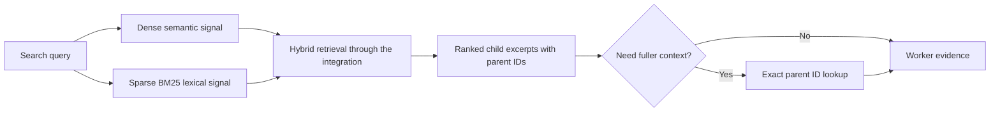

# Dense and Sparse Hybrid Retrieval

Hybrid retrieval addresses evidence discovery: **which indexed text is relevant to this query?** This guide explains why dense semantic vectors and sparse lexical signals complement each other and how the project combines them. Neither signal, nor their combination, guarantees a correct final answer.

For question decomposition and final synthesis, read [Parallel Agent Reasoning and Aggregation](parallel-agent-reasoning.md#L1). Use [storage managers](storage-managers.md#L1) for parent/child persistence and [the database walkthrough](db.md#L1) for the broader storage design.

## 1. Why Dense and Sparse Retrieval?

Dense representations encode semantic relationships. Sparse representations place weight on a smaller set of lexical features. In this repository the sparse approach is BM25, not another chat model.

| Signal | Useful For | Important Limitation |
|---|---|---|
| Dense semantic similarity | Paraphrases and related concepts expressed with different wording | A conceptual match can miss a critical identifier or return a plausible but irrelevant passage |
| Sparse BM25 lexical matching | Keywords, names, error identifiers, and terminology-heavy questions | Relevant passages can use different words; tokenization is not an exact-byte-match guarantee |
| Hybrid retrieval | Combining those complementary signals | Adds indexing/query work and still needs evaluation; it is not automatically better for every corpus |

For example, "How is conversation remembered?" could benefit from a semantic match to checkpointing. A query containing `InMemorySaver` can benefit from lexical overlap with that specific API name. These examples illustrate expected strengths, not measured retrieval results.

Both representations describe the **same child documents**. Parent text is stored separately and loaded by ID when fuller context is useful. Parent expansion is not another embedding search.

## 2. Hybrid Retrieval in This Project

[Configuration](../../project/config.py#L15) selects `Qwen/Qwen3-Embedding-0.6B` for dense embeddings and `Qdrant/bm25` for sparse embeddings. [VectorDbManager construction](../../project/db/vector_db_manager.py#L11) creates `HuggingFaceEmbeddings` and `FastEmbedSparse`; their respective backends are SentenceTransformers and FastEmbed. The [dependency guide](../../DEPENDENCIES.md#L1) explains those integration/backend layers.

[create_collection](../../project/db/vector_db_manager.py#L29) configures dense cosine vectors plus a sparse-vector slot. [get_collection](../../project/db/vector_db_manager.py#L59) returns a `QdrantVectorStore` with `RetrievalMode.HYBRID`, both providers, and the sparse-vector name. Ingestion passes child documents to that wrapper; query-time [child search](../../project/rag_agent/tools.py#L12) calls its `similarity_search` with the query, hit limit, and score threshold.

This diagram separates the retrieval signals conceptually; it does not imply two Python agent nodes. The integration handles hybrid retrieval/fusion. This project does not define a custom fusion formula or reranker in that path, so it should not be described as manually averaging dense and sparse scores.

## 3. Child Search and Parent Expansion

The search returns children, not complete source files. A worker can then call [parent retrieval](../../project/rag_agent/tools.py#L51), which uses [load_content](../../project/db/parent_store_manager.py#L38) to fetch one stored parent by ID. Several child hits can share a parent. A retrieval score is not a probability that the final answer is true.

Do not picture one dense-search agent and one sparse-search agent. Each question worker has the same retrieval tools; its child search uses the configured hybrid collection. Retrieval finds evidence, while the [parallel reasoning workflow](parallel-agent-reasoning.md#L1) decides how separate parts of the request are investigated and synthesized.

## 4. Tradeoffs and Design Limits

| Design Choice | Benefit | Cost or Risk |
|---|---|---|
| Dense semantic retrieval | Can find related concepts without the same wording | Semantic similarity can overlook decisive identifiers or retrieve irrelevant passages |
| Sparse BM25 retrieval | Can match specific terminology and names | Different wording and tokenization can limit useful matches |
| Hybrid retrieval | Semantic and lexical signals can cover different failure cases | More representation/indexing work; quality must be measured on relevant queries |
| Exact parent expansion | Restores fuller context around a child hit | Loading a parent does not establish that it supports the generated claim |

Using both signals is a design tradeoff, not a universal requirement. Their extra indexing and query work should be justified by evaluation for the actual corpus and questions. Proposed improvements such as caching or reranking need explicit design and evaluation; they are not guarantees of the current code.

## 5. Interview Practice

| Question | Answer Guidance |
|---|---|
| Why use both dense and sparse retrieval? | They provide complementary semantic and lexical evidence signals. Both operate on the same child corpus, and measured task results should justify the extra work. |
| Are dense and sparse retrieval the two parallel agents? | No. Workers correspond to rewritten questions; each worker uses the same hybrid-search tool. |
| Does retrieving a parent require another embedding search? | No. The parent tool loads one stored parent using the child's parent ID. |
| Does this project implement its own fusion formula? | No. The configured vector-store integration handles hybrid retrieval/fusion in this path. |
| Does a high retrieval score prove the answer is correct? | No. Retrieval relevance and generated-answer faithfulness are different concerns. |

**Interview summary:** Hybrid retrieval combines semantic and lexical signals over the same child corpus. Parent expansion adds context through exact lookup; neither step independently verifies the answer.