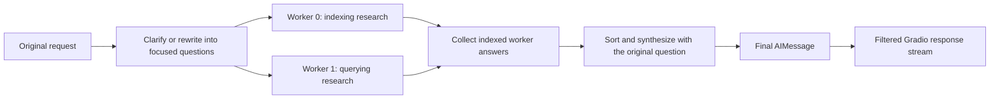

# Parallel Agent Reasoning and Aggregation

This guide explains **Parallel Agent Reasoning -> Aggregation -> Final Response**: focused workers investigate separate parts of a request, then another model invocation synthesizes their findings into one answer. This design divides research; it does not independently verify the final answer.

For how each worker discovers evidence, read [Dense and Sparse Hybrid Retrieval](hybrid-retrieval.md#L1). Use [the graph walkthrough](Graph.md#L1) for complete wiring and [agent decisions](rag-agent.md#L1) for loop details.

## 1. Why Parallel Research and Aggregation?

Consider: "How are documents indexed, and how are they queried?" The request contains two information needs. A focused worker can investigate indexing while another investigates querying. Aggregation brings the findings back to the original question instead of merely displaying disconnected answers.

This is a **fan-out/fan-in**, or map-reduce-style, pattern. It is not a debate between competing agents, a collection of separately trained models, or independent final-answer verification.



The example shows two clear, separable questions. An unclear request takes the clarification path first. A simple request may yield only one worker; the graph can still use the same aggregation path.

## 2. Implementation: Rewrite, Dispatch, Research

### Rewrite the Request

[rewrite_query](../../project/rag_agent/nodes.py#L110) combines the current message with the conversation context and asks for structured query analysis. Clear results populate `rewrittenQuestions`; unclear results preserve the pending query and produce a clarification message.

The rewrite prompt asks for at most three questions, but [QueryAnalysis](../../project/rag_agent/schemas.py#L4) does not impose a maximum list length. Structured output checks the declared format; it does not establish that the decomposition is useful or factually correct.

### Dispatch with Send

[route_after_rewrite](../../project/rag_agent/edges.py#L7) returns either the clarification destination or one `Send` object per rewritten question. Each object requests an execution of the same registered `agent` node with its own input state. The routing logic below matches the implementation, with type annotations omitted:

```python
from langgraph.types import Send
from core.execution_logger import log_route


def route_after_rewrite(state):
  if not state.get("questionIsClear", False):
    decision = "request_clarification"
  else:
    decision = [
      Send("agent", {"question": query, "question_index": idx, "messages": []})
      for idx, query in enumerate(state["rewrittenQuestions"])
    ]
  log_route("after_rewrite", decision, state)
  return decision
```

`question_index` preserves the original subquestion order. Each invocation starts with its own question and empty research-message list, rather than appending all workers' research into one shared message history.

#### Example: Generate Two Worker Requests

For two rewritten questions, the router produces two separate `Send` objects:

```python
example_state = {
  "questionIsClear": True,
  "rewrittenQuestions": [
    "How are documents indexed?",
    "How are documents queried?",
  ],
}

dispatches = route_after_rewrite(example_state)

for dispatch in dispatches:
  print(dispatch.node, dispatch.arg)
```

Expected output:

```text
agent {'question': 'How are documents indexed?', 'question_index': 0, 'messages': []}
agent {'question': 'How are documents queried?', 'question_index': 1, 'messages': []}
```

Calling the router directly only constructs the dispatch objects; it does not run the workers. `Send` is a routing message, not LangGraph's separate `Command` API. The graph must consume these objects through a registered conditional edge.

#### Register the Worker and Conditional Route

These relevant lines from [create_agent_graph](../../project/rag_agent/graph.py#L21) connect the router to the compiled worker subgraph and final aggregation:

```python
agent_subgraph = agent_builder.compile()

graph_builder = StateGraph(State)
graph_builder.add_node("agent", agent_subgraph)

graph_builder.add_conditional_edges("rewrite_query", route_after_rewrite)
graph_builder.add_edge(["agent"], "aggregate_answers")
```

This is a wiring excerpt, not a standalone graph: the existing factory also registers `rewrite_query`, `aggregate_answers`, and the other nodes, adds the remaining edges, and compiles the main graph. After `rewrite_query` runs, LangGraph evaluates the router and schedules one worker invocation for each returned `Send`. The `agent` node is registered once; the example schedules two invocations, not two separately named nodes or two dedicated model processes. Worker outputs accumulate through the reducer described in section 3 before aggregation.

### Run the Worker Subgraph

The [worker graph](../../project/rag_agent/graph.py#L28) uses [AgentState](../../project/rag_agent/graph_state.py#L26). Its orchestrator invokes the tool-bound model, `ToolNode` executes requested tools, and the worker can repeat retrieval or compress its context before answering.

[Budget routing](../../project/rag_agent/edges.py#L18) limits further tool use using per-worker iteration and requested-tool counters. Compression can reduce working context but is lossy. These mechanisms bound research; they do not prove that the worker has enough evidence.

All workers use the same configured model and tools. Each child-search call uses hybrid retrieval; there is no separate dense worker versus sparse worker. The [shared model binding](../../project/rag_agent/graph.py#L22) does not mean each worker gets a dedicated Ollama process or GPU.

## 3. Implementation: Collect, Join, Aggregate

[collect_answer](../../project/rag_agent/nodes.py#L298) packages the completed worker result with its question index and retained contexts. One illustrative entry in `agent_answers` looks like this:

```json
{
  "index": 0,
  "question": "How are documents indexed?",
  "answer": "The worker's generated explanation of indexing.",
  "contexts": ["The actual retained tool evidence would appear here."]
}
```

This is a shape example, not an executed result. The main graph's [accumulate_or_reset](../../project/rag_agent/graph_state.py#L5) reducer combines workers' answer lists. It also recognizes a reset marker so answers from the previous request do not remain in the new request's collection. Ordinary replacement semantics would risk losing results from parallel updates.

The [main graph wiring](../../project/rag_agent/graph.py#L54) registers the fan-out route and the transition from `agent` to `aggregate_answers`. The outer graph schedules aggregation after the worker subgraph invocations for that fan-out complete; the project does not manually create a thread pool or join Python threads.

[aggregate_answers](../../project/rag_agent/nodes.py#L313) then:

1. Reads the collected worker results and handles the no-answer case.
2. Sorts the results by `index`, not completion order.
3. Formats each worker's `answer` string and combines those strings with `originalQuery`.
4. Calls the model using [get_aggregation_prompt](../../project/rag_agent/prompts.py#L131).
5. Returns the synthesis as a final `AIMessage`, alongside conversation-history cleanup updates.

The critical boundary is that the aggregator receives **the original query and worker answer strings, not the workers' raw `contexts` arrays**. Those contexts remain useful for evaluation, but they are not automatically rechecked during final synthesis. A worker's unsupported claim can survive aggregation, and the final model can introduce another error.

## 4. Final Response Versus Display

There is a final model invocation in aggregation; "Final Response" is not necessarily a separate verification node. [ChatInterface.chat](../../project/core/chat_interface.py#L113) streams graph messages with node metadata. Its filters expose query analysis and tool activity separately and append ordinary final-answer tokens only from `aggregate_answers`.

Streaming changes how the response is delivered to the UI, not whether its claims are correct. A source-name list or a fluent combined answer is not independent evidence validation.

## 5. Tradeoffs and Design Limits

| Design Choice | Benefit | Cost or Risk |
|---|---|---|
| Focused worker contexts | Each worker can research one part without carrying every other worker's conversation | Decomposition can omit a dependency or duplicate retrieval |
| Graph-level fan-out | Independent tasks can be scheduled concurrently | The shared model/backend may queue or serialize requests; speedup is not guaranteed |
| Separate aggregation | Connects findings to the original request and restores question order | Adds a model call and can lose qualifications or propagate unsupported claims |
| Bounded research and compression | Limits work and context growth | Budgets can stop useful research; compression can drop decisive evidence |

Independent subquestions fit this workflow. If one question depends on a result produced by another, sequential planning or explicit state dependencies may be more appropriate. Parallel workers do not automatically provide that dependency chain.

For simple questions, extra decomposition and aggregation may not justify their latency and cost. Proposed improvements such as hard fan-out limits or evidence-aware final verification need explicit design and evaluation; they are not guarantees of the current code.

## 6. Interview Practice

| Question | Answer Guidance |
|---|---|
| What does Send contribute? | It selects the worker node and supplies a per-question input state, including an ordering index. |
| Why does the shared answer field need a reducer? | It must accumulate multiple worker outputs rather than overwrite earlier results; it also needs per-request reset behavior. |
| Does finishing first make a worker answer appear first? | No. Aggregation explicitly sorts results by their original question index. |
| Why can the final answer still be ungrounded? | Worker generation, compression, and synthesis can introduce errors; aggregation currently consumes answer strings rather than independently verifying raw evidence. |
| Will two workers halve latency? | Not necessarily. Model serving, shared resources, graph overhead, and the final synthesis call affect wall-clock time. |

**Interview summary:** Focused workers divide research; the graph accumulates and orders their results; aggregation integrates their findings. Distinguish those intended benefits from measured speedups and correctness guarantees.