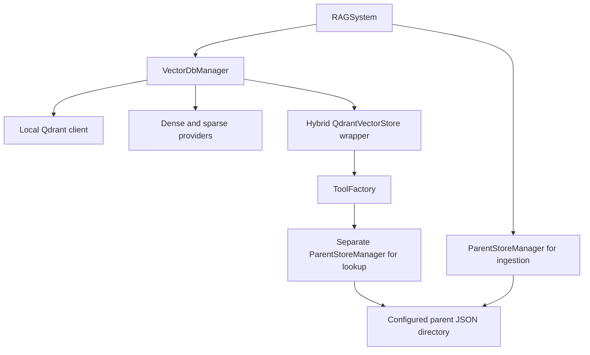
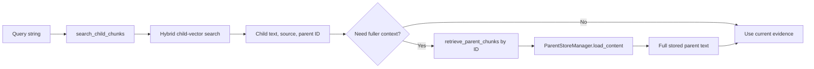

# Chunk Storage and Query Managers

This guide explains how [VectorDbManager](../../project/db/vector_db_manager.py#L7) and [ParentStoreManager](../../project/db/parent_store_manager.py#L8) support hierarchical retrieval. The first connects child documents to a searchable vector collection; the second keeps larger parent text available through exact ID-based file lookup.

Read [the chunking walkthrough](document-chunker.md#L1) for how the documents are created, [the database overview](db.md#L1) for the broader storage model, and [the core guide](core.md#L1) for application lifecycle.

## 1. Why Two Managers?

| Component | Owns | Main Operation | Does Not Do |
|---|---|---|---|
| `DocumentChunker` | In-memory parent and child `Document` objects | Split text and attach metadata | Persist or search the results |
| `VectorDbManager` | A local Qdrant client and dense/sparse embedding providers | Prepare a collection and return its hybrid vector-store wrapper | Store parent JSON or choose which parent to expand |
| `ParentStoreManager` | A configured directory of parent JSON files | Save or load a parent by ID | Embed text, rank results, or perform semantic search |
| `DocumentManager` and retrieval tools | Coordination between those components | Ingest documents; search children; optionally load a parent | Provide a cross-store transaction or validated final answer |

Small children provide a finer search granularity. Larger parents can restore surrounding context after a useful hit. The `parent_id` in child metadata connects the two representations, but it is an application convention, not a database-enforced foreign key.

## 2. Object Wiring and Shared Paths

[RAGSystem construction](../../project/core/rag_system.py#L13) creates one vector manager and one parent manager. Its [initialize](../../project/core/rag_system.py#L23) method then creates/checks the collection, obtains its wrapper, and passes that wrapper to the tool factory.

The vector manager's [constructor](../../project/db/vector_db_manager.py#L11) opens `QdrantClient(path=config.QDRANT_DB_PATH)` and constructs `HuggingFaceEmbeddings` and `FastEmbedSparse`. This is not a side-effect-free settings object: local storage is opened, and embedding-provider initialization can load model resources. The managers do not initialize the Ollama chat model.

The parent manager's [constructor](../../project/db/parent_store_manager.py#L11) creates its directory if necessary. [ToolFactory](../../project/rag_agent/tools.py#L6) constructs a **separate** parent-manager instance for reading. It does not receive `rag.parent_store` directly; both instances normally reach the same configured directory.



The [three configured paths](../../project/config.py#L6) separate Markdown files, Qdrant data, and parent JSON. Changing a collection name does not change the Markdown or parent directory. Likewise, the parent constructor's default `store_path=config.PARENT_STORE_PATH` is evaluated when its module is imported; changing the config variable later does not rewrite that default. Custom isolation must account for both paths and all manager instances, rather than assuming a new collection name isolates everything.

## 3. The Stored Data Contract

The chunker returns parent pairs and child documents. A synthetic parent with ID `handbook_p0` could be written as `handbook_p0.json` with this payload:

```json
{
  "page_content": "# Guide\nInstall dependencies, then start the application.",
  "metadata": {
    "H1": "Guide",
    "source": "handbook.pdf",
    "parent_id": "handbook_p0"
  }
}
```

This illustrates fields, not actual corpus content or chunk sizes. [save](../../project/db/parent_store_manager.py#L15) writes `page_content` and `metadata` as UTF-8 JSON. Children carry shorter `page_content` and the same parent/source metadata. Qdrant's text/vector payload and child-point IDs are handled by the integration, not custom ID allocation in the chunker.

### Child Records Are Qdrant Points, Not Parent JSON Files

Each child has its own Qdrant point ID, dense and sparse vectors, and a text/metadata payload. Under the wrapper's current defaults, the payload keys are `page_content` and `metadata`. The following example shows selected point fields; vectors are omitted:

```json
{
  "id": "<generated-child-point-id>",
  "payload": {
    "page_content": "Install dependencies.",
    "metadata": {
      "H1": "Guide",
      "source": "handbook.pdf",
      "parent_id": "handbook_p0"
    }
  }
}
```

Several child points can have different point IDs but the same `metadata.parent_id`. That is the **many-children-to-one-parent** relationship. The child point ID identifies a search record; `parent_id` identifies the larger JSON record to load. Children are not stored as separate files in the parent directory or embedded as a child array inside the parent JSON.

### Parent Lookup Changes the Return Shape

[load_content](../../project/db/parent_store_manager.py#L38) transforms the stored record into a different Python dictionary:

```json
{
  "content": "# Guide\nInstall dependencies, then start the application.",
  "parent_id": "handbook_p0",
  "metadata": {
    "H1": "Guide",
    "source": "handbook.pdf",
    "parent_id": "handbook_p0"
  }
}
```

The retrieval tool formats that dictionary as `Parent ID`, `File Name`, and `Content` text for the model. The JSON file, loaded dictionary, and tool-result string are three representations of the same evidence; they are not interchangeable API return types.

## 4. VectorDbManager: Collection Lifecycle

| Method | Logic |
|---|---|
| [_dense_vector_size](../../project/db/vector_db_manager.py#L16) | Embeds the literal query `"test"` and measures the resulting vector length |
| [_collection_vector_size](../../project/db/vector_db_manager.py#L20) | Reads `.size` from a single vector configuration, or the first entry of a named-vector dictionary; otherwise returns no size |
| [create_collection](../../project/db/vector_db_manager.py#L29) | Probes the expected dimension, creates a missing collection, or checks a known existing dimension |
| [get_collection](../../project/db/vector_db_manager.py#L59) | Returns a new `QdrantVectorStore` wrapper using the manager's existing client and embedding providers |
| [delete_collection](../../project/db/vector_db_manager.py#L51) | Deletes the collection if present; wraps failures in a `RuntimeError` |

For a **new collection**, creation configures dense vectors with the measured size and cosine distance, plus a sparse-vector slot named by `SPARSE_VECTOR_NAME`. Dense Qwen embeddings and sparse BM25 are selected in [configuration](../../project/config.py#L15).

For an **existing collection**, a detected nonzero dimension mismatch raises a `ValueError` asking for reindexing. A matching dimension permits reuse; an unavailable/falsey size is not rejected by this particular guard. This helper inspects only the first entry of a named-vector configuration. It is not a comprehensive schema validator or a fingerprint of embedding model, revision, preprocessing, distance settings, and corpus version. The integration may perform additional validation when its wrapper is constructed.

The wrapper uses `RetrievalMode.HYBRID` with both embedding providers and the configured sparse-vector name. Fusion and vector-store operations are delegated to that integration: this class does not implement a custom fusion algorithm or reranker. It also does not expose a custom insertion method; the ingestion caller invokes `collection.add_documents(children)` on the returned wrapper.

`get_collection` does not open a second `QdrantClient`, but constructing a wrapper is not a promise of zero validation or embedding work. Its errors are rethrown as `RuntimeError("Unable to initialize Qdrant collection ...")` with the original exception as their cause.

## 5. ParentStoreManager: JSON Lifecycle

| Method | Logic and Boundary |
|---|---|
| [save](../../project/db/parent_store_manager.py#L15) | Writes one JSON record to `<parent_id>.json`; an existing file can be overwritten |
| [save_many](../../project/db/parent_store_manager.py#L22) | Sequentially saves `(parent_id, Document)` pairs; earlier writes can remain if a later one fails |
| [load](../../project/db/parent_store_manager.py#L32) | Reads/parses JSON; accepts an ID or a filename ending in `.json` |
| [load_content](../../project/db/parent_store_manager.py#L38) | Returns the normalized dictionary shown above; missing required payload fields raise |
| [load_content_many](../../project/db/parent_store_manager.py#L51) | Deduplicates IDs with a set, sorts by recognized numeric suffix, and loads each record |
| [list_sources](../../project/db/parent_store_manager.py#L55) | Scans JSON files and returns sorted distinct `metadata.source` values |
| [delete_many](../../project/db/parent_store_manager.py#L26) | Deletes named parent files when they exist; other filesystem failures can propagate |
| [clear_store](../../project/db/parent_store_manager.py#L66) | Clears the configured directory's contents without coordinating vector deletion |

The [numeric sorting helper](../../project/db/parent_store_manager.py#L47) recognizes endings such as `_p2` and `_parent_12`. Unrecognized endings receive sort key zero. Equal numeric keys do not have a guaranteed cross-document order because the input was converted to a set.

Missing files, invalid JSON, and unsuitable payload structure are not converted to empty results by `load`. `list_sources` catches only `OSError` and `JSONDecodeError`; it is not a general schema validator. A valid JSON value with the wrong shape can still fail. The parent retrieval tool catches load failures and returns `PARENT_RETRIEVAL_ERROR: ...`.

Writing JSON does not by itself provide atomic publication, transactional batches, or crash recovery. The manager has no temporary-file/rename protocol, locking layer, or journal. Its IDs are assumed to be trusted: there is no explicit parent-ID/path validation or document-authorization check in these methods. Treat robust identity validation and access control as additional production work.

## 6. Write Path: Parents Before Children

[DocumentManager.add_documents](../../project/core/document_manager.py#L13) coordinates the actual persistence sequence:


Parents are saved first so an indexed child can refer to an already available parent. However, the JSON directory and Qdrant collection are **not one transaction**. If child insertion partially succeeds, the exception path can delete parents and generated Markdown without rolling back every inserted child. Direct `save_many` calls can also leave partial parent batches.

The outer document manager's existing-Markdown skip rule is not content-version detection or an integrity check. Likewise, a source appearing in `list_sources` proves only that a parseable source value was found; it does not prove that the corresponding child vectors exist or are searchable.

## 7. Query Path: Search, Then Optional Parent Lookup



[_search_child_chunks](../../project/rag_agent/tools.py#L12) passes a query, hit limit, and configured score threshold to the hybrid wrapper. The result contains children, not complete source files. Several hits can share a parent ID, and a retrieval score is not final-answer confidence.

[_retrieve_parent_chunks](../../project/rag_agent/tools.py#L51) loads one chosen parent by ID through the separate parent-manager instance. It performs no embedding, semantic search, or automatic expansion of every hit. Whether the worker needs that extra context is a tool/model decision, not a vector-manager policy. For concrete `search_tool.invoke(...)` and `retrieve_tool.invoke(...)` examples, see the [chunking and tool walkthrough](document-chunker.md#L1).

## 8. Operational and Consistency Limits

- **Local ownership:** `QdrantClient(path=...)` uses local storage. The app and a notebook cannot independently open the same local index concurrently; a server-backed deployment is a separate architecture choice.
- **Shared namespace:** Collection names do not isolate the parent directory. Stem/position-based parent IDs can collide or change meaning after re-chunking.
- **Incomplete version checks:** Equal vector dimensions do not make different embedding models or preprocessing compatible.
- **Independent deletion:** Deleting a collection does not remove parent JSON, and clearing parents does not delete child vectors. Only higher-level coordination attempts both.
- **No automatic repair:** There is no reconciliation job, referential-integrity enforcement, or versioned publication mechanism linking these stores.

Disk persistence is different from validated durability and different again from the graph's in-memory conversation checkpoints. Proposed improvements include stable document/version IDs, verified publication of complete parent/child batches, orphan reconciliation, explicit ownership/path injection, and identity-scoped access. None is automatically supplied by using LangChain wrappers.

## 9. Interview Practice

| Question | Answer Guidance |
|---|---|
| Why split vector search and parent storage? | Children give search granularity; parents restore context by ID without embedding every full parent in this design. The tradeoff is coordinating two stores. |
| What does construction do versus getting a collection? | Construction opens a local client and creates embedding providers. Getting a collection returns a wrapper around them, not a new independent database client. |
| Does dimension validation make an old index safe to reuse? | It catches a known dimension mismatch, not all changes in model, preprocessing, or collection configuration. |
| Why save parents before adding children? | It makes parent evidence available before child references become searchable, but cannot eliminate failures without a publication/transaction strategy. |
| Why can source listing succeed while retrieval fails? | Listing reads parent metadata; child vectors may be missing, and listing suppresses some file errors. It is not an end-to-end health check. |
| Is a new collection enough for tenant isolation? | No. Parent paths, document identity, authorization, and session ownership must also be isolated or explicitly shared. |

**Tradeoff exercise:** Design a versioned reindex with uninterrupted reads. Specify how children reference a parent version, how a complete version is published, what happens on partial failure, and how old or orphaned records are retired. Separate those proposed safeguards from the current local-demo implementation.